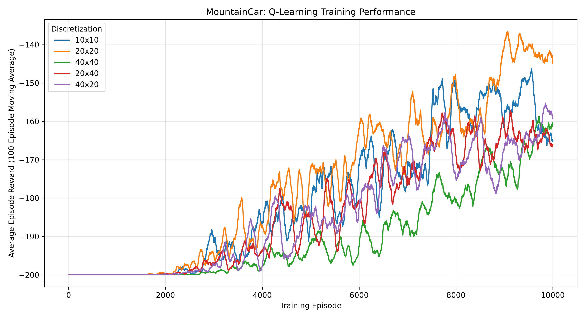
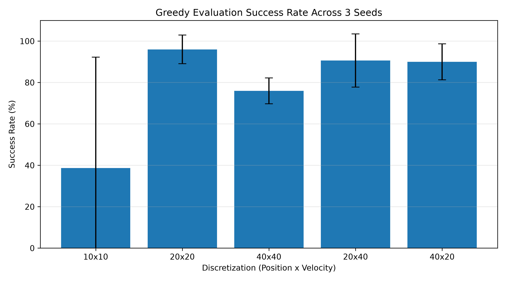
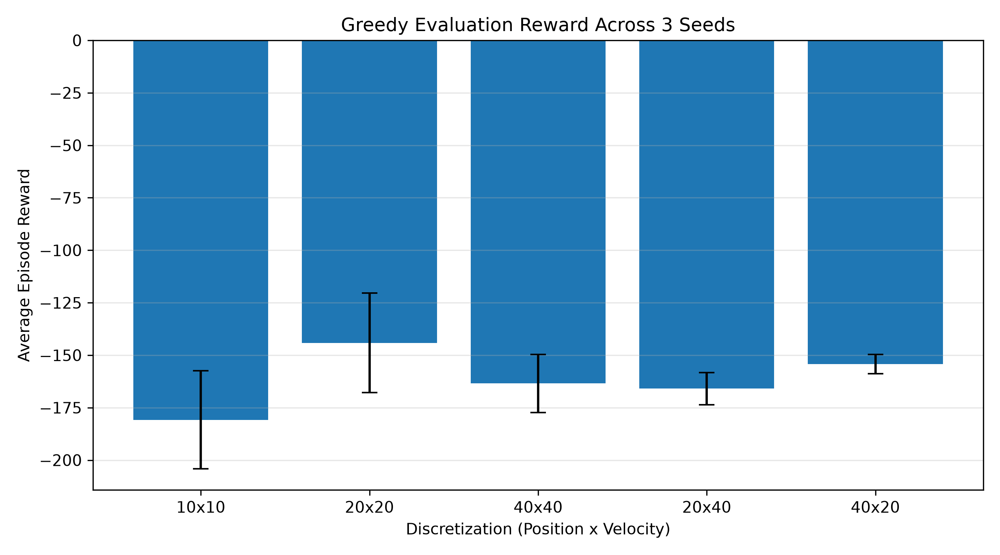
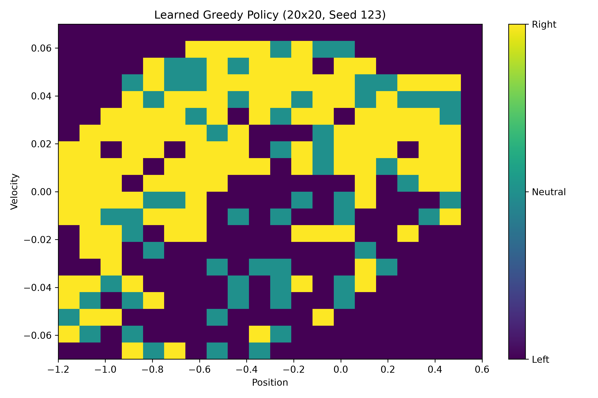

# MountainCar: Tabular Q-Learning with State Discretization

A reinforcement learning project that solves Gymnasium's **MountainCar-v0** environment using tabular Q-Learning and investigates how discretization resolution affects learning performance.

The project compares five state-space discretization configurations across three random seeds, examining training convergence, greedy-policy performance, and learned behavior.

## Overview

MountainCar is a classic reinforcement learning environment in which an underpowered car must reach a goal at the top of a hill.

The car cannot simply accelerate directly toward the goal. Instead, it must build momentum by moving back and forth between the hills.

The environment has a continuous observation space, while tabular Q-Learning requires discrete states. This project addresses that challenge using **uniform state discretization**.

### Objectives

- Implement tabular Q-Learning from scratch using NumPy.
- Convert continuous observations into discrete state indices.
- Train an agent using epsilon-greedy exploration.
- Compare different position and velocity discretization resolutions.
- Evaluate learned greedy policies across multiple random seeds.
- Visualize learning curves, evaluation performance, and learned policies.

## Environment

The project uses `MountainCar-v0` from Gymnasium.

| Property | Description |
|---|---|
| Observation space | Continuous position and velocity |
| Position range | [-1.2, 0.6] |
| Velocity range | [-0.07, 0.07] |
| Action 0 | Accelerate left |
| Action 1 | No acceleration |
| Action 2 | Accelerate right |
| Reward | -1 per time step |
| Goal | Reach position ≥ 0.5 |
| Episode limit | 200 steps |

The objective is to reach the goal in as few steps as possible, maximizing the cumulative reward.

## Methodology

### 1. State discretization

Because MountainCar has continuous observations, each observation is mapped into a discrete state.

For a continuous value \(x\), the discretized index is calculated as:

\[
i = \operatorname{clip}\left(
\left\lfloor \frac{x-x_{\min}}{x_{\max}-x_{\min}}N \right\rfloor,
0,N-1
\right)
\]

where \(N\) is the number of bins.

The resulting state is represented by:

\[
s=(i_{\text{position}},i_{\text{velocity}})
\]

The Q-table has dimensions:

\[
Q \in \mathbb{R}^{N_p \times N_v \times 3}
\]

where \(N_p\) and \(N_v\) represent the numbers of position and velocity bins.

### 2. Q-Learning

The agent uses the standard Q-Learning update rule:

\[
Q(s,a)\leftarrow Q(s,a)+\alpha
\left[r+\gamma\max_{a'}Q(s',a')-Q(s,a)\right]
\]

For terminal transitions, the next-state value is omitted.

The agent uses an epsilon-greedy behavior policy during training:

- With probability \(\epsilon\), select a random action.
- Otherwise, select an action with the highest Q-value.

Ties between equally valued actions are broken randomly.

### 3. Training

Each configuration is trained independently using the following parameters:

| Parameter | Value |
|---|---|
| Learning rate (\(\alpha\)) | 0.1 |
| Discount factor (\(\gamma\)) | 0.99 |
| Initial epsilon | 1.0 |
| Minimum epsilon | 0.01 |
| Epsilon decay | 0.9995 per episode |
| Training episodes | 10,000 |
| Training seeds | 42, 123, 456 |

The exploration rate decreases after every episode:

\[
\epsilon \leftarrow \max(0.01,0.9995\epsilon)
\]

Training rewards, episode successes, and learned Q-tables are saved for later analysis.

### 4. Experimental configurations

Five discretization resolutions are evaluated:

| Configuration | Position bins | Velocity bins | Q-table entries |
|---|---:|---:|---:|
| 10×10 | 10 | 10 | 300 |
| 20×20 | 20 | 20 | 1,200 |
| 40×40 | 40 | 40 | 4,800 |
| 20×40 | 20 | 40 | 2,400 |
| 40×20 | 40 | 20 | 2,400 |

Each trained agent is evaluated for 100 episodes using a greedy policy (\(\epsilon=0\)) and the same set of evaluation seeds.

In total, the experiment includes **15 training runs and 1,500 evaluation episodes**.

## Results

### Greedy evaluation performance

The table reports mean performance across three independent training seeds.

| Configuration | Mean success rate | Mean episode reward |
|---|---:|---:|
| 10×10 | 38.7% | -180.79 |
| **20×20** | **96.0%** | **-144.15** |
| 40×40 | 76.0% | -163.50 |
| 20×40 | 90.7% | -165.93 |
| 40×20 | 90.0% | -154.24 |

**20×20 achieved the highest mean success rate and best mean episode reward** among the tested configurations.

### Training learning curves



The figure shows mean training rewards across three seeds, smoothed using a 100-episode moving average.

All configurations improve with training, although learning speed and final performance differ. The 20×20 configuration achieves the strongest late-training average reward, while 40×40 improves more gradually.

### Evaluation success rate



Bars represent mean success rates across three training seeds, with error bars showing one sample standard deviation.

The 20×20 configuration achieves the highest average success rate. The 10×10 configuration exhibits substantial variation between training runs.

### Evaluation episode reward



The 20×20 configuration achieves the best average episode reward.

Because the environment provides a reward of -1 per step, less negative rewards indicate that the agent generally completes episodes in fewer steps or reaches the goal more often.

### Learned greedy policy



This heatmap visualizes the highest-valued action for each discretized position–velocity state using the 20×20 model trained with seed 123.

- Purple: accelerate left
- Teal: no acceleration
- Yellow: accelerate right

The policy illustrates how action selection depends on both position and velocity.

For states with tied Q-values, the visualization selects the first maximum-valued action, whereas the evaluation agent randomly breaks ties.

## Key Findings

### 1. Discretization resolution matters

The 10×10 configuration uses a relatively coarse representation of the continuous state space. Its greedy evaluation success rate varies dramatically between training seeds.

Increasing the resolution to 20×20 substantially improves average performance in these experiments.

### 2. More bins do not guarantee better performance

Although 40×40 contains four times as many Q-values as 20×20, it performs worse under the same training budget.

A finer discretization provides more detailed state information but also increases the number of state-action values that must be learned.

### 3. Training success does not guarantee greedy-policy success

Some agents achieve high success rates during epsilon-greedy training but perform poorly when evaluated without exploration.

This demonstrates the importance of evaluating the learned policy independently of the training behavior policy.

### 4. Random seeds influence results

For the 10×10 configuration, evaluation success ranges from 1% to 100% across the three training seeds.

Multiple independent training runs are therefore important when comparing reinforcement learning algorithms or hyperparameters.

### 5. Balanced discretization performed best in this experiment

The 20×20 configuration provides the strongest combination of average reward and success rate among the five tested resolutions.

However, these results are based on three training seeds and one training budget. They do not establish that 20×20 is optimal for all settings.

## Project Structure

```text
MountainCar/
├── src/
│   ├── discretizer.py
│   ├── q_learning.py
│   ├── train.py
│   ├── evaluate.py
│   └── visualize.py
├── experiments/
│   └── compare_bins.py
├── tests/
│   ├── test_discretizer.py
│   └── test_q_learning.py
├── results/
│   ├── models/
│   └── plots/
│       ├── learning_curves.png
│       ├── evaluation_success.png
│       ├── evaluation_rewards.png
│       └── policy_20x20_seed123.png
├── explore_env.py
├── requirements.txt
└── README.md
```

## Installation

### 1. Clone the repository

```bash
git clone https://github.com/YOUR_USERNAME/MountainCar-Q-Learning.git
cd MountainCar-Q-Learning
```

Replace `YOUR_USERNAME` with your GitHub username and update the repository name if necessary.

### 2. Create a virtual environment

```bash
python -m venv .venv
```

On Windows PowerShell:

```powershell
.\.venv\Scripts\Activate.ps1
```

### 3. Install dependencies

```bash
pip install -r requirements.txt
```

The main dependencies are Gymnasium, NumPy, Matplotlib, and pytest.

## Usage

Run all commands from the project root.

### Run tests

```bash
python -m pytest tests/ -v
```

### Train and evaluate experiments

```bash
python -m experiments.compare_bins
```

Configure the selected discretizations and seeds inside `experiments/compare_bins.py`. Enable the training call to train new models, or leave it disabled to evaluate previously saved Q-tables.

### Generate visualizations

```bash
python -m src.visualize
```

Figures are saved to `results/plots/`.

## Limitations and Future Work

Several improvements could extend this project:

- Evaluate additional training seeds for stronger statistical comparisons.
- Investigate different learning rates and exploration schedules.
- Compare uniform discretization with tile coding.
- Evaluate SARSA and Expected SARSA against Q-Learning.
- Investigate state visitation and Q-value coverage.
- Create a rendered demonstration of the trained agent.
- Extend the approach to environments with larger or more complex state spaces.

## Conclusion

This project demonstrates how tabular Q-Learning can be applied to an environment with continuous observations through state discretization.

Experiments across five discretization resolutions and three training seeds show that state representation strongly affects learning and evaluation performance.

Among the tested configurations, **20×20 discretization achieved 96% mean greedy evaluation success and an average episode reward of -144.15**.

The results highlight the importance of selecting an appropriate state representation, accounting for randomness, and evaluating learned policies independently from training.

## Technologies

Python · Gymnasium · NumPy · Matplotlib · pytest

## References

- [Gymnasium MountainCar-v0 documentation](https://gymnasium.farama.org/environments/classic_control/mountain_car/)
- Sutton, R. S., & Barto, A. G. (2018). *Reinforcement Learning: An Introduction*, 2nd edition. [Free online book](http://incompleteideas.net/book/the-book-2nd.html)
